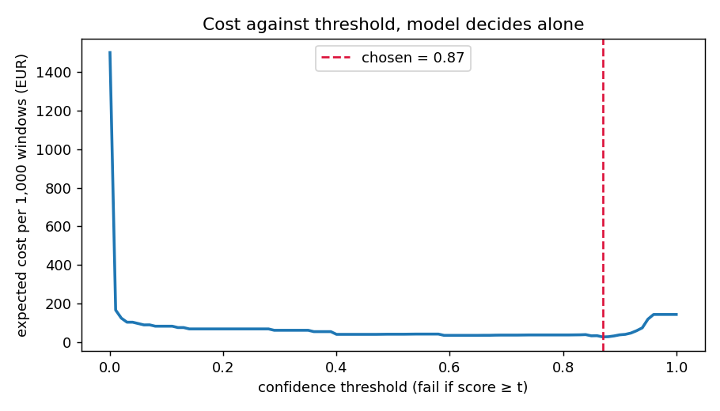

# Assignment 2 Report

- **Name**: James HAunso
- **Student ID**: 19661
- **Email**: jhaunso.ieu2022@student.ie.edu
- **Group**: [BBADBA 5A]

###Business problem, and the cost of being wrong

My idea/business problem is simple and is to do with optemising in a factory. SO a factory solders components onto circuit boards. After soldering, a camera will take 40 close up pictures of each boards solder joints. With the pictures, we try to find out whether the joints will work and therefore pass inspection. Doing this can save costs on inspection. Back to windows. 

For every window the model will decide one of 3 things:

- pass, the board will continue down the line
- fail, the board goes to a rework technician who redoes the joinbt
- review, which makes a human look at the image and decide 

A window (which shows the board) is defective if it has at least one bad joint. (bridged, detached/defective, double joint)

(False Negative) A missed defect costs about 72 euros. The longer a defect is missed, the more expensive it becomes. I assumed 80% of false negativces are caught at fcuntional test aka the techniction gets it and fixes and its still broken.  

A false positive costs about 1.5 euros, 2 min of rework technician checking and touching up a joint that was already ok. A true positive costs the same but there its worth paying because it prevents a 72 eur miss. A correct pass costs nothing. A human review costs about 0.12 euros, which is 12 seconds of an inspector at 35 euros an hour. I assumed reviewers catch 95% of defects and wrongly fail 2% of good windows.

The asymmetry. A missed defect costs about 48 times more than a false alarm. On its own that would mean failing anything that looks a bit suspicious. But defects are rare: I assume only 0.2% of windows contain one. So for every defective window there are about 499 good ones, and false alarms on all those good windows add up quickly. The two effects pull in opposite directions, which is why I chose the threshold by testing every value and taking the cheapest one, not by guessing.

Base rate. Through-hole soldering lines often have 90 to 95% of boards come out right first time. If about 8% of boards have a defect and each board has 40 windows, that is roughly 0.2% of windows. The test set has far more defects than that (65% of test windows contain one), because the dataset was collected to show defects. So I take the model’s error rates from the test set and then weight them by the 0.2% production rate, instead of reading the costs straight off the test counts.

What this means for the rest of the report. The number that matters most is how many defective windows the model catches while keeping false alarms low, not the mAP score. The Good class helps the model learn what a normal joint looks like, but it doesn’t drive any decision on its own.

###Dataset

Workspace / project / version: work-6qkmv / solder-2-hcmiq / version 37
Link: https://universe.roboflow.com/work-6qkmv/solder-2-hcmiq/dataset/37
License: CC BY 4.0. I used the public dataset as it is, without forking it, so anyone can download the same version.

So every image is a greyscale closeup of a couple of soldered components. The camera in the factory would take these images. Every join t has a box with one of labels. Good, Bridge, Detached, Double or Insufficient. Bridge, Detached, Double and Insufficient are defects. Good is a joint that should pass.

The data set fits the problem because it shows the same thing the actualy factory camera would see, and from the same angle too. Also very important that it lables good joints and not just bad ones, this is because we need all lables to have a false alarm rate to put a cost on. When looking for datasets i had to actually find one that had both good and bad joints because some datasets only have ruined boards.

How I split it. Version 37 comes with 4,239 training images and 608 validation images, and no test split. Roboflow added augmentation to the training images only: each original photo appears three times with flips, rotations, brightness changes and noise. The 608 validation images are untouched. So:

- I used Roboflow’s 608 validation images as my test set. The model never sees them during training or when choosing the best epoch.
- I made my own validation set by taking 10% of the original photos from the training split (141 of 1,413), together with all three augmented copies of each. That gave 3,816 training images and 423 validation images. I split by original photo, not by file, because if one copy of a photo were in training and another in validation, the model would be tested on near-duplicates of what it trained on and the validation score would look better than it really is.

###What the dataset’s composition implies

Class balance (number of labelled joints):

class	train	val	test	median box size (share of image, test)
Bridge	894	93	140	4.5%
Detached	1,599	189	274	1.8%
Double	375	57	62	2.5%
Good	7,017	765	1,108	2.0%
Insufficient	657	69	97	1.7%

Train has 3,816 images, validation 423 and test 608. About two thirds of the images in every split contain a defect.

- Good joints dominate. In training there are about 19 Good joints for every Double joint, so I expect the rare defect classes to do worst.

- The Double result is the least reliable. There are only 62 Double joints in the test set, so a couple of mistakes change its score a lot. Insufficient with 97 is also thin.

= Only 213 test windows are fully good. The false alarm rate is measured on just these, so one extra false alarm moves it by about half a percentage point. 
That matters because on a real line almost every window is good, so false alarms drive most of the cost.

- The test set has far more defects than a real line: 65% of windows instead of about 0.2%. That is fine for checking if the model can tell good from bad. 
But I can’t read the costs straight from the test counts, so I scale the error rates to the real 0.2%.

- The joints are small but visible. A typical joint covers about 2% of the image, roughly 90 by 90 pixels. Insufficient joints are the smallest, which may be one reason they are harder.

- All splits come from the same camera and boards. So the test score shows how the model does on similar images. It says nothing about a new board design or different lighting.

- The labels are mostly clean. Training found only one duplicated label, in one photo.

###Finetuning and baselines

I used object detection with yolo11s. Each window shows two or three joints, and I need to know which joint is bad, so detection fits better than classifying the whole image. I chose the small version over the nano one because the joints are small and the bigger model can pick up more detail. It is still fast, about 12 milliseconds per image.

Training. I trained on Google Colab with a free T4 GPU, starting from the COCO pretrained weights. I used 80 epochs, image size 640, batch size 16 and seed 0. Training would stop early if the validation score stopped improving for 20 epochs, but it kept improving, so all 80 epochs ran. That took about 1.4 hours. The saved weights come from the best validation epoch. Safe to say this took a second and I was afraid i would need to run it again. 

Results on the same 608 test images:

model	AP50	mAP50-95	image AUC	cost per 1,000 windows
yolo11s finetuned	0.965	0.920	0.987	27.77 euros
COCO model, no finetuning	0	0	0.564	142.93 euros
predict nothing	0	0	0.500	144.00 euros

Image AUC is the chance that a defective window gets a higher score than a good one. A score of 0.5 is the same as guessing.

The COCO model has never seen solder joints, so it has no matching classes and its AP is zero. It calls the joints things like bottles, people and traffic lights. To still test it on the real decision, I used its most confident box of any kind as the score. That gave an AUC of 0.56, close to guessing, and a cost almost the same as doing nothing.

Predicting nothing means every board passes. Every defect is missed, which costs 144 euros per 1,000 windows.

The finetuned model beats both by a wide margin. It almost always ranks defective windows above good ones, and on its own it cuts the cost by about 80% compared with doing nothing. That is about what I expected. A general model can’t judge solder joints, and this dataset is large and consistent enough for finetuning to work well.

###Per-class evaluation and failure modes: 
A window is positive if it has at least one defect: Bridge, Detached, Double or Insufficient. Good is the negative class.

| class | test joints | precision | recall | AP50 | mAP50-95 |
|---|---|---|---|---|---|
| Bridge | 140 | 0.964 | 0.958 | 0.986 | 0.938 |
| Detached | 274 | 0.964 | 0.971 | 0.989 | 0.984 |
| Double | 62 | 0.921 | 0.935 | 0.972 | 0.872 |
| Good | 1108 | 0.969 | 0.988 | 0.991 | 0.938 |
| Insufficient | 97 | 0.928 | 0.801 | 0.886 | 0.869 |
| all | | 0.949 | 0.931 | 0.965 | 0.920 |

The overall AP50 of 0.965 is carried by Good and Detached, which are large classes and both near 0.99. The average hides that Insufficient is clearly weaker.

Confusion matrix at confidence 0.25. Rows are the true class, columns the prediction.

| true / predicted | Bridge | Detached | Double | Good | Insufficient | missed |
|---|---|---|---|---|---|---|
| Bridge | 135 | 0 | 1 | 3 | 0 | 1 |
| Detached | 0 | 265 | 0 | 3 | 5 | 1 |
| Double | 1 | 0 | 57 | 4 | 0 | 0 |
| Good | 2 | 0 | 1 | 1099 | 2 | 4 |
| Insufficient | 0 | 12 | 0 | 10 | 75 | 0 |

The main failure is Insufficient. 12 are called Detached, which is harmless because the window still fails. But 10 are called Good, and those are the dangerous misses. A thin insufficient joint looks a lot like a good one, and it is the type that cracks later at the customer.

With my thresholds, 82% of Detached windows are failed by the model alone, but only 9% of Insufficient ones. Most Insufficient windows go to review instead. 8 of 395 defective test windows pass by mistake: 5 Insufficient and 3 Bridge. In 6 of them the model sees no defect at all.

Two of those 8 have OK in the original factory file name but are labelled defective, so some misses may be label disagreements rather than model errors.

###Cost matrix and operating point

| outcome | cost per window | where it comes from |
|---|---|---|
| missed defect (FN) | 72 euros | 80% caught at functional test for 15 euros, 20% returned by the customer for 300 euros |
| false alarm (FP) | 1.50 euros | about 2 minutes of a rework technician |
| caught defect (TP) | 1.50 euros | the same rework, now worth doing |
| correct pass (TN) | 0 euros | nothing happens |
| human review | 0.12 euros | 12 seconds of an inspector at 35 euros an hour |

Base rate: I assume 0.2% of windows contain a defect. About 8% of boards have a defect and each board has 40 windows.

The test set is 65% defective, so I don't read costs straight from the test counts. I take the model's error rates on defective and good windows separately and weight them by the real 0.2%:

cost per window = 0.002 x cost on defective windows + 0.998 x cost on good windows

I tried every threshold from 0 to 1 in steps of 0.01. A window fails if its score is at or above the threshold, and I took the cheapest one.

The cheapest single threshold is 0.87. It costs 27.77 euros per 1,000 windows, catches 92.4% of defective windows and wrongly fails 0.94% of good ones. A bootstrap over the test images puts the cost between about 13 and 44 euros, which is wide because there are only 213 good test windows.

0.87 is high even though a miss costs 48 times more than a false alarm. That is because defects are rare. There are about 499 good windows for every defective one, so a lower threshold creates many false alarms, and they add up faster than the misses they prevent. The model should only fail a window when it is very sure.

Which assumptions matter most:

| change | best threshold |
|---|---|
| my assumptions | 0.87 |
| base rate 0.5% instead of 0.2% | 0.59 |
| base rate 2% | 0.40 |
| a miss costs 300 euros instead of 72 | 0.40 |
| a miss costs 15 euros | 0.94 |
| a false alarm costs 0.50 euros | 0.59 |

The answer depends most on the base rate. If more than about 0.5% of windows were defective, I would lower the threshold to around 0.6. The euro figures for rework matter less.

 #### What a person still has to check

I use two thresholds. Below 0.40 the window passes, from 0.40 to 0.94 it goes to a person, and at 0.94 or above it fails. I picked them by trying every pair of thresholds and taking the cheapest.

On the test set this sends:

| | pass | review | fail |
|---|---|---|---|
| defective windows (395) | 8 | 193 | 194 |
| good windows (213) | 208 | 5 | 0 |

At the real base rate of 0.2% this costs 12.93 euros per 1,000 windows, between about 10 and 16 euros in the bootstrap. That is less than half of the 27.77 euros the model costs on its own.

Review load:
- The line makes 2,000 boards a day with 40 windows each, so 80,000 windows a day.
- 2.44% go to review, about 1,950 windows a day.
- At 12 seconds each that is 6.5 hours of checking.
- With 6.5 productive hours per person, that is 1 reviewer.

Is that realistic? Yes, with one adjustment. The line runs two shifts, so I would put one reviewer on each shift, each busy about half the time. That leaves room for breaks and busy periods, and they can do other inspection work in between. One risk is that about 96% of the windows a reviewer sees are actually good, so they may get bored and miss real defects. My assumption that reviewers catch 95% of defects should be checked in practice.

Compared with the alternatives:

| policy | euros per 1,000 windows | euros per day |
|---|---|---|
| do nothing, pass everything | 144.00 | 11,520 |
| a person checks every window | 159.99 | 12,799 |
| fail everything | 1,500.00 | 120,000 |
| model decides alone | 27.77 | 2,221 |
| model plus human review | 12.93 | 1,035 |

Having a person check every window costs more than doing nothing. Defects are so rare that you pay for 500 checks to find about one. The model with a review band saves about 10,500 euros a day compared with doing nothing. Adding the reviewer saves about 1,200 euros a day more than the model alone, while costing only one person per shift.

###Limitations & next steps

1. Insufficient joints are the weak spot. The model passes 5.7% of windows with an insufficient joint, and those are the defects most likely to fail at the customer. Next step: give Insufficient boxes their own lower thresholds so more of them go to review, and add more insufficient examples to the training data. Training at a higher image size might also help, since they are the smallest joints.

2. The false alarm rate rests on only 213 good test windows. On a real line false alarms drive most of the cost, so this is the number I most need to measure better. Next step: collect a few thousand defect-free windows from the line and rerun the threshold sweep.

3. All the images come from one camera and the same kinds of boards. The results may not hold for a new board design, a different camera or new lighting. Next step: run the model in a shadow pilot on new boards, where it makes decisions alongside the current inspection but doesn't act on them, and compare.

4. The costs and the reviewer accuracy are my assumptions. Next step: measure them during the pilot. That means real rework times, how many escaped defects come back from customers, and how often reviewers miss a defect, checked by having a second person re-check a sample.

5. Some labels may be wrong. Two of the eight missed windows are named OK by the factory but labelled defective. Next step: have an expert re-check the misses and other borderline cases before trusting the per-class numbers fully.

6. I trained only once, with one seed. I don't know how much the results would change with a different random start. Next step: train two or three more times with different seeds and report the spread.

7. The base rate can change over time, for example when a new product starts or a machine drifts. Next step: track the share of windows the model fails or sends to review each day, and rerun the cost sweep if it moves a lot.

###Generative AI use disclosure

I used Claude (Anthropic) as an assistant throughout. I chose the problem and made the final decisions; Claude suggested options and approaches, such as candidate datasets, cost assumptions and how to score each window, wrote most of the pipeline and dashboard code, explained the methods, and drafted parts of this report.

I set up the repository and Roboflow access, ran the training on Colab, checked the submission, tested the dashboard, reviewed the results and rewrote the report in my own words. I can explain every decision in it. If you made it this far, thanks for reading! I think i did this assignment better than the 1st and i hope I do well on the in class assignment. 